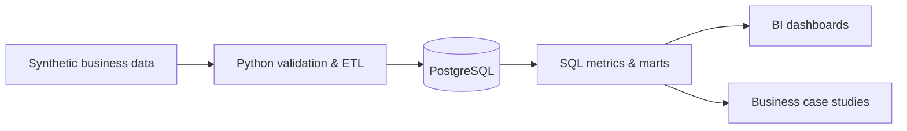

# AXIOM Analytics
### End-to-End Business Intelligence & SQL Analytics Platform

> **Status: Foundation / documentation stage** · **30-day build:** Nov 13 – Dec 12, 2026 · **Dataset:** synthetic · **Target release:** v1.0

AXIOM Analytics is a portfolio project demonstrating the full analytics lifecycle for a **fictional e-commerce business**: requirements discovery, PostgreSQL data modeling, synthetic data engineering, advanced SQL, metric governance, business intelligence and decision-oriented reporting.

**Important:** This repository is under active development. The architecture and features below are planned; the implementation status is tracked in [Delivery Log](docs/PROGRESS.md).

## The business problem

An online retailer has fragmented records of customers, orders, payments, refunds and campaigns. Leadership needs trustworthy answers to practical questions: What drives net sales? Which customers return? Where does checkout conversion drop? Which marketing channels deserve investment?

## Proposed solution

## Technical scope

**Core:** PostgreSQL · SQL (CTEs, window functions, joins, query plans) · Python · data validation · relational modeling · Metabase · Docker Compose.

**Analysis:** revenue reconciliation, AOV, customer cohorts, retention, RFM segmentation, sales funnel, campaign performance, refunds and cancellations.

**System analysis:** stakeholder requirements, business rules, ER diagrams, data dictionary, metric specifications and documented decisions.

## Documentation

| Document | Purpose |
|---|---|
| [Project Charter](docs/PROJECT_CHARTER.md) | Business problem, scope, stakeholders, success criteria |
| [30-Day Roadmap](docs/ROADMAP.md) | Daily deliverables, dates, release gates |
| [Architecture](docs/ARCHITECTURE.md) | Target components and data flow |
| [Data Model](docs/DATA_MODEL.md) | Planned entities, relationships and constraints |
| [Metric Dictionary](docs/METRICS.md) | Explicit KPI definitions and reconciliation rules |
| [Delivery Log](docs/PROGRESS.md) | Verified progress versus planned work |
| [Development Workflow](docs/CONTRIBUTING.md) | Standards, tests and commit conventions |

## Delivery plan

| Sprint | Days | Outcome |
|---|---|---|
| 1. Discovery & Design | 01–07 | Requirements, ERD and schema |
| 2. Data & SQL | 08–14 | Synthetic data, quality checks and KPI queries |
| 3. Advanced Analytics | 15–21 | Cohorts, RFM, funnel, marketing and optimization |
| 4. BI & Delivery | 22–30 | Marts, ETL, dashboards and reproducible case study |

Follow the [day-by-day schedule](docs/ROADMAP.md) for specific tasks.

## Portfolio quality bar

Every analytical case must include a decision question, documented assumptions, source SQL, validation, interpretation and limitations. Results from generated data must never be represented as real business outcomes.

## Getting started

**Not available yet.** Database setup, generation scripts and local dashboard deployment will be added in later sprints. See the [roadmap](docs/ROADMAP.md) and [progress log](docs/PROGRESS.md) for the current state.

## License

MIT. See [LICENSE](LICENSE).
