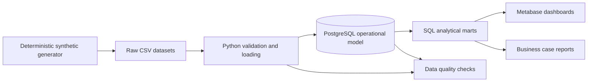

# Architecture — Proposed Design

> **Status:** Target architecture. Components are not considered implemented until tracked in the progress log.

## System context



## Planned repository layout

```text
axiom-analytics/
├── README.md
├── docs/
│   ├── PROJECT_CHARTER.md
│   ├── ROADMAP.md
│   ├── ARCHITECTURE.md
│   ├── METRICS.md
│   ├── DATA_MODEL.md
│   ├── PROGRESS.md
│   └── CONTRIBUTING.md
├── database/
│   ├── migrations/
│   └── seeds/
├── data/
│   └── samples/
├── src/
│   ├── generator/
│   └── pipelines/
├── sql/
│   ├── exploratory/
│   ├── cases/
│   ├── marts/
│   └── performance/
├── dashboards/
├── reports/
├── tests/
├── docker-compose.yml
└── .github/workflows/
```

## Architectural decisions

- **Database:** PostgreSQL for relational constraints, SQL analytics and query plans.
- **Generator:** Python with fixed random seed and configuration for dataset size.
- **BI:** Metabase (preferred for local reproducibility); alternatives may be documented.
- **Execution:** Docker Compose for PostgreSQL and BI; scripts for generation/loading.
- **Analytics:** Version-controlled SQL, separated into exploration, reusable marts and business cases.
- **Testing:** SQL assertions plus Python tests for generation and pipeline behavior.

## Data layers

1. **Source:** generated records representing fictional business operations.
2. **Validated operational model:** typed relational tables with keys and constraints.
3. **Analytical marts:** standardized views at documented grains.
4. **Consumption:** dashboards, reports and evidence-backed recommendations.

## Data governance

Only fictional synthetic records. Do not commit real personal information, passwords, connection strings or large binary dumps. Use environment variables for local secrets, and publish only safe example configurations.

## Performance plan

Begin with representative small datasets. For optimization experiments, scale data volume, capture query plan, timing and row counts before/after, and avoid attributing improvement to an index without repeatable evidence.
