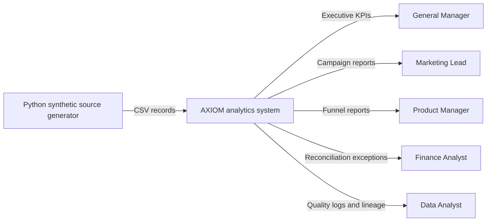
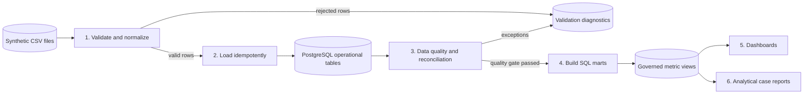

# Day 04 — Data Flow Specification

**Status:** Proposed architecture and data contracts; not an implemented ETL.

## DFD-0: System context

## DFD-1: Internal data flow

## Logical datasets and contracts

| Data stream | Proposed grain | Keys | Required fields | Validation |
|---|---|---|---|---|
| customers | one customer | customer_id | created_at, region, acquisition_source | unique key, valid timestamp |
| catalog | category/product | category_id, product_id | category_id, list_price | non-negative price, valid FK |
| orders | one order | order_id | customer_id, placed_at, status | valid customer and status |
| order_items | one order line | order_item_id | order_id, product_id, quantity, unit_price, discount_amount | quantity > 0, discount <= gross |
| payments | one attempt | payment_id | order_id, attempted_at, amount, status | non-negative amount, valid order |
| refunds | one refund | refund_id | payment_id, refunded_at, amount, status | settled amount <= remaining capture |
| campaigns | one campaign | campaign_id | channel, start_date, end_date, spend | end >= start, spend >= 0 |
| sessions | one session | session_id | started_at, customer_id nullable, campaign_id nullable | valid optional FKs |
| events | one event | event_id | session_id, occurred_at, event_type | valid session and taxonomy |

**Design dependency:** the existing DATA_MODEL.md proposes a refund table without a `status` field. Day 05 data dictionary must add this field or explicitly define all stored refunds as settled. Until resolved, refund ingestion is not implementable without ambiguity.

## Transformation boundaries

1. **Raw:** untrusted generated records; preserve batch ID, seed and file hash.
2. **Validated:** enforce type/field rules and reject bad records with reason codes.
3. **Operational:** use PK/FK/CHECK constraints and documented status transitions.
4. **Analytical:** aggregate by explicit grains; separate item, payment and refund aggregations to prevent row multiplication.
5. **Presentation:** dashboards read only governed marts, not arbitrary raw joins.

## Load order and idempotency

**Proposed sequence:** categories → products → customers → campaigns → orders → order_items → payments → refunds → sessions → events. Order may change once precise event and attribution constraints are finalized.

**Idempotency:** stable synthetic IDs; insert/upsert by primary key; a second run with identical seed must not duplicate rows. Changes to seed/configuration should use a new batch ID or explicit rebuild policy.

## Error classes

| Code | Trigger | Action |
|---|---|---|
| DQ-001 | Duplicate source primary key | Reject batch or quarantine record |
| DQ-002 | Broken foreign key | Reject affected record |
| DQ-003 | Invalid monetary amount | Reject affected record |
| DQ-004 | Illegal status transition | Report and block KPI eligibility |
| DQ-005 | Refunds exceed capture | Reject refund and report |
| DQ-006 | Event timestamp outside session | Quarantine event |
| DQ-007 | Missing optional campaign attribution | Keep as unattributed, not an error |
| DQ-008 | Financial reconciliation mismatch | Block release of dependent KPI |

## Operational metadata

Record generation seed, generator version, batch ID, source row counts, rejected row counts, load timestamps, and query version. Avoid claiming this logging exists until implemented.
