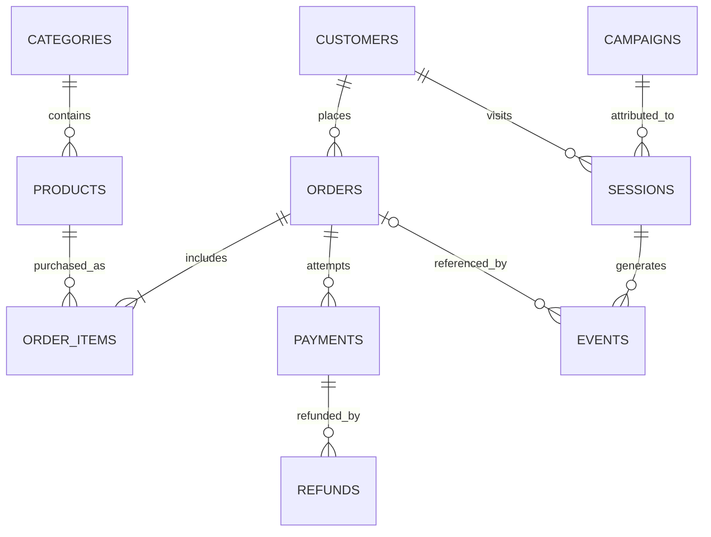

# Data Model — Initial Proposal

> This is a design specification, **not** an implemented database schema.

## Core entities

| Table | Grain | Primary key | Main attributes |
|---|---|---|---|
| customers | One customer | customer_id | created_at, region, acquisition_source |
| categories | One category | category_id | category_name |
| products | One product | product_id | category_id, list_price, active |
| orders | One checkout order | order_id | customer_id, placed_at, status |
| order_items | One product line in an order | order_item_id | order_id, product_id, quantity, unit_price, discount_amount |
| payments | One payment attempt | payment_id | order_id, attempted_at, amount, status |
| refunds | One refund event | refund_id | payment_id, refunded_at, amount, reason |
| campaigns | One marketing campaign | campaign_id | channel, start_date, end_date, spend |
| sessions | One visit/session | session_id | customer_id nullable, campaign_id nullable, started_at |
| events | One behavioral event | event_id | session_id, occurred_at, event_type, order_id nullable |

## Relationships

## Rules to validate

- Quantity must be positive; unit prices and discounts non-negative.
- Line discount cannot exceed line subtotal.
- Order total derives from item-level values; avoid double counting across joins.
- Payment attempts are distinct from successful payments.
- Refund amount cannot exceed the successfully captured amount, including multiple partial refunds.
- Event timestamps must be consistent with session lifecycle.
- Sessions can be anonymous; campaign attribution can be missing.
- Monetary values use fixed precision (`NUMERIC`), never floating point.
- Timestamps use `TIMESTAMPTZ` and UTC storage; report timezone is explicit.

## Modeling decisions pending

Order status state machine; shipping and taxes; campaign spend granularity; refund allocation to line items; anonymous identity stitching; attribution window; session timeout. Resolve these before final DDL and metrics.
