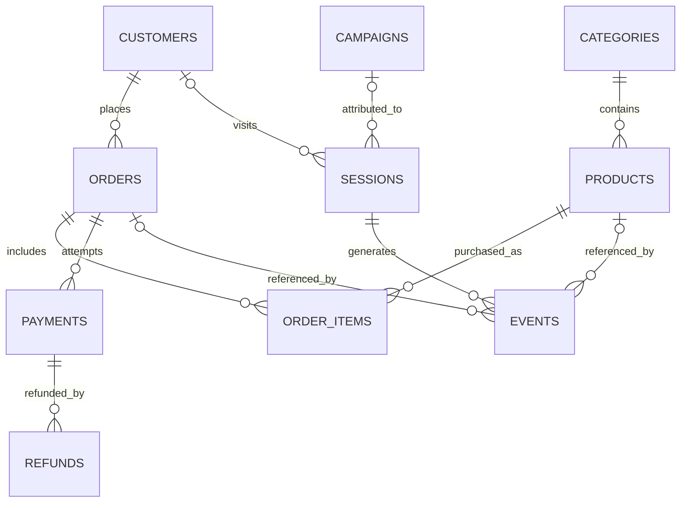

# Data Model — v1.0 Design Baseline

> **Status:** Designed, not yet implemented. See [field-level data dictionary](DATA_DICTIONARY.md) for canonical types, nullability, enums and business constraints.

## Core entities

| Table | Grain | Primary key | Main attributes |
|---|---|---|---|
| customers | One customer | customer_id | created_at, region, acquisition_source |
| categories | One category | category_id | category_name |
| products | One product | product_id | category_id, product_name, list_price, active |
| orders | One checkout order | order_id | customer_id, placed_at, status |
| order_items | One order line | order_item_id | order_id, product_id, quantity, unit_price, discount_amount |
| payments | One payment attempt | payment_id | order_id, attempted_at, amount, status |
| refunds | One refund request/settlement | refund_id | payment_id, requested_at, refunded_at, amount, status, reason |
| campaigns | One marketing campaign | campaign_id | campaign_name, channel, start_date, end_date, spend |
| sessions | One visit | session_id | customer_id, campaign_id, started_at, ended_at |
| events | One behavioral event | event_id | session_id, occurred_at, event_type, order_id, product_id |

## Relationships

## Rules

- Completed eligible orders must have at least one item and one full captured payment; this is a cross-table invariant.
- Refund requests can be pending, failed or settled. Only settled refunds with a settlement timestamp enter financial KPIs.
- Multiple partial refunds are allowed but cannot cumulatively exceed the captured amount.
- Session boundaries are explicitly generated with `started_at` and `ended_at`; events must fall within them.
- Campaign `spend` covers the entire campaign period; daily spend analysis is not supported.
- Line discounts cannot exceed line subtotal. Store money in `NUMERIC(14,2)` and timestamps in `TIMESTAMPTZ`.
- Analytical joins must pre-aggregate order items, payments and refunds to their appropriate grain to prevent row multiplication.

## Deferred design

Partial captures, tax/shipping, daily campaign spend and multi-touch attribution are excluded from MVP. Day 06 reviews relationships and cardinalities; Day 07 introduces executable DDL.
