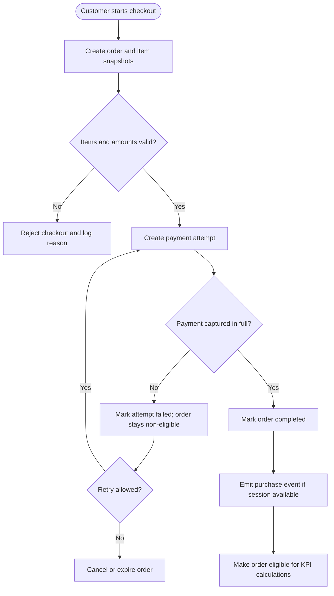
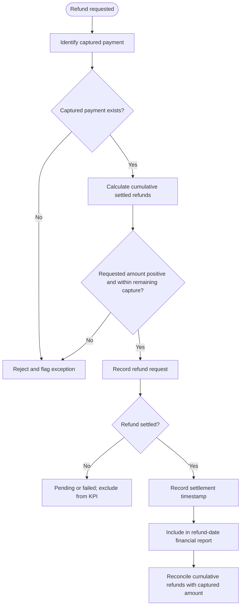
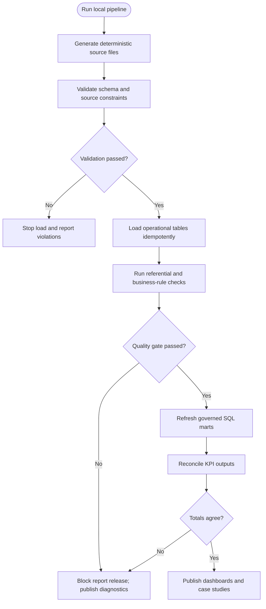
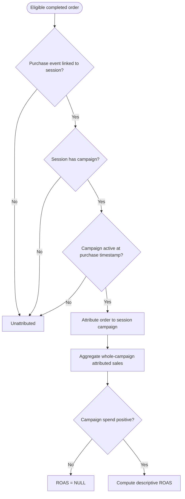

# Day 04 — Business Process Models

**Planned day:** 2026-11-16 · **Prepared:** 2026-11-15 · **Status:** Design complete; processes are conceptual and not deployed.

This document models the fictional e-commerce business from operational actions to analytical outcomes. Mermaid diagrams are BPMN-inspired process representations, **not BPMN 2.0 executable models**.

## P-01: Order placement and settlement

**Inputs:** customer, order items, catalog prices, discount snapshots, payment result.  
**Outputs:** order, order_items, payment attempts, optional purchase event.  
**Controls:** FR-01, FR-04, FR-05, FR-06; BRULE-01, BRULE-02.  
**Exception policy:** retries create distinct payment attempts; only one successful full capture is allowed for an eligible order. Inconsistent states are reported rather than silently counted.

## P-02: Refund settlement and reconciliation

**Inputs:** captured payment, refund amount, settlement outcome.  
**Outputs:** settled refund, exception record.  
**Controls:** FR-06, FR-10; BRULE-03, BRULE-04.  
**Invariant:** total settled refunds for a payment <= captured amount. The data generator will include partial-refund fixtures.

## P-03: Analytics delivery and control gates

**Data provenance:** synthetic source → validated operational tables → governed metrics → dashboards.  
**Controls:** FR-02, FR-03, FR-10, FR-15, FR-16; NFR-01, NFR-02, NFR-03, NFR-10.  
**Execution status:** planned only; no pipeline, schema or dashboard exists yet.

## P-04: Campaign attribution

**Assumptions:** single-touch, session-contained attribution; no claim of incremental causality. Campaign spend is a whole-campaign total, not a daily time series.  
**Controls:** FR-11, FR-12; BRULE-07, BRULE-08.

## Process ownership and exception routing

| Process | Business owner | Technical owner (project role) | Failure response |
|---|---|---|---|
| P-01 | Finance / Operations | Data analyst | Exclude invalid order; report mismatch |
| P-02 | Finance | Data analyst | Reject over-refund; log exception |
| P-03 | Analytics | Data engineer / analyst | Fail quality gate; do not publish |
| P-04 | Marketing | Data analyst | Mark unattributed; disclose assumptions |

## Traceability

P-01 → UC-01, UC-02; P-02 → UC-02; P-03 → FR-02/03/10/15/16; P-04 → UC-04. See [SRS](REQUIREMENTS.md), [use cases](USE_CASES.md) and [ADR-005](ADR/005-mvp-business-rules.md).
